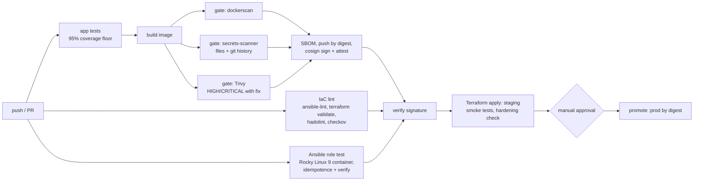

# secure-delivery-lab

A small service delivered the way I think production software should be: built reproducibly, scanned by gates that **block** the release, signed, deployed to a provisioned environment, smoke-tested, and promoted only after approval, with a rollback path. The host it runs on is hardened by an Ansible role that is tested in CI.

The app is deliberately tiny. The point of the repository is everything around it.

[](https://github.com/NathaliaGF/secure-delivery-lab/actions/workflows/pipeline.yml)


## The pipeline



Nothing is pushed unless every gate passes, and the image that is pushed is **the exact image that was scanned**. Deployment verifies the signature first; promotion verifies it again.

| Stage | Tool | Blocks the release when |
|---|---|---|
| App tests | pytest | a test fails or coverage drops below 95% |
| Dockerfile / compose | [dockerscan](https://github.com/NathaliaGF/docker-security-scanner) | any finding of MEDIUM or worse (root user, privileged, plaintext secret, mutable tag, no limits...) |
| Secrets | [secrets-scanner](https://github.com/NathaliaGF/secrets-scanner) | a secret of MEDIUM or worse in the tree **or in the git history** |
| Image CVEs | Trivy | a HIGH or CRITICAL vulnerability that has a fix |
| Dockerfile style | hadolint | any rule violation |
| Workflows | checkov | an insecure workflow pattern (exceptions are written next to the code, with the reason) |
| Ansible | ansible-lint, `production` profile | any violation |
| Ansible behaviour | Rocky Linux 9 container | the role changes anything on a second run, or the final state does not match |
| Terraform | fmt, validate, variable validations | formatting, invalid config, or an image not pinned by digest |
| Supply chain | cosign (keyless, Sigstore) | the image signature does not match this repository's pipeline identity |
| Staging | smoke tests + `verify-hardening.sh` | an endpoint misbehaves, Prometheus cannot scrape the app, or the container is not hardened |

## Hardening, and how each item is proven

| Control | Where | Proven by |
|---|---|---|
| Base image pinned by digest, dependencies hash-locked | `Dockerfile`, `app/requirements.txt` | a tampered package or base fails the build |
| Non-root user (UID 10001), no shell, package manager removed | `Dockerfile` | dockerscan, `verify-hardening.sh` |
| Read-only root filesystem, all capabilities dropped, `no-new-privileges`, memory limit, ports on 127.0.0.1 | `compose.yml`, `infra/terraform` | dockerscan (compose) and `verify-hardening.sh` against the **running** staging container |
| Every GitHub Action pinned to a commit SHA, least-privilege `permissions` | `.github/workflows` | checkov; Dependabot proposes updates |
| Image must be referenced by digest | Terraform variable validation | `terraform plan` rejects `:latest` |
| Host hardening (SSH, sysctl, auditd, nftables, password policy...) | `ansible/roles/rhel_cis_hardening` | `sshd -T` effective config, `nft -c`, file assertions, idempotence, in a Rocky Linux 9 container |

`scripts/verify-hardening.sh` is itself tested (`scripts/test_scripts.sh`): it must accept a hardened `docker inspect` document and reject eight different mutations of it.

## Repository layout

```text
app/                    Flask service: probes, Prometheus metrics, JSON logs, security headers (tests inside)
Dockerfile              multi-stage, digest-pinned, non-root
compose.yml             local stack (hardened)
compose.observability.yml   Prometheus + Grafana (provisioned dashboard, password as a Docker secret)
infra/terraform/        staging stack on Docker: network, app, Prometheus
ansible/                role rhel_cis_hardening, playbook, verify playbook
scripts/                smoke tests, container hardening check, tests for both
.github/workflows/      pipeline.yml, rollback.yml
docs/                   architecture notes, threat model, rollback runbook
```

## Run it locally

```bash
docker compose up -d --build                      # the app on http://127.0.0.1:8080
curl -s localhost:8080/healthz

export GF_ADMIN_PASSWORD='choose-one'             # app + Prometheus + Grafana
docker compose -f compose.yml -f compose.observability.yml up -d --build
# Grafana http://127.0.0.1:3000   Prometheus http://127.0.0.1:9090

make test lint scan                               # the pipeline's checks, locally
```

## Setting it up in your own fork

1. **Environments → production → Required reviewers.** Without it the `promote` job runs without waiting for anyone.
2. **Branch protection on `main`**: require the `pipeline` checks and a pull request.
3. **Packages**: the image is published to GHCR as private by default; change visibility if you want to pull it elsewhere.
4. **Code scanning** (Security tab) receives the Trivy, secrets-scanner and dockerscan SARIF reports.

## Rollback

`rollback.yml` points `:prod` back at an earlier image, given its digest (printed in the summary of each `promote` run). It only accepts `ghcr.io/...@sha256:<digest>`, verifies the signature, and needs the same approval as a promotion. See `docs/runbook-rollback.md`.

## What this is not

Being clear about scope matters more than a long feature list.

- **"Production" is a promoted tag, not a server.** There is no real production host. Staging is a real deployment (Terraform applies the stack on the runner's Docker daemon, the pipeline smoke-tests it and destroys it), but the final promotion only moves the `:prod` tag to the verified digest.
- **The Ansible role is tested in a container.** That proves the files, the effective `sshd` configuration, the firewall syntax and idempotence. It cannot prove service state, runtime `sysctl` values, SELinux enforcement or the firewall actually loading. Those tasks are skipped in the container and were not exercised there.
- **CIS Benchmark:** the role covers *areas* of it. It makes no compliance claim and was not audited with an official tool.
- **Checkov has no checks for the Docker Terraform provider**, so Terraform is validated by `fmt`, `validate` and variable validations, not by Checkov.
- **Terraform state is local and ephemeral**, which is right for a stack that is destroyed after each run and wrong for anything long-lived.
- Not covered: network policy between containers beyond one private network, a WAF, runtime detection (Falco), secrets rotation, multi-environment promotion.

## Related

- [docker-security-scanner](https://github.com/NathaliaGF/docker-security-scanner): gate 1
- [secrets-scanner](https://github.com/NathaliaGF/secrets-scanner): gate 2

## License

MIT, see [LICENSE](LICENSE).
